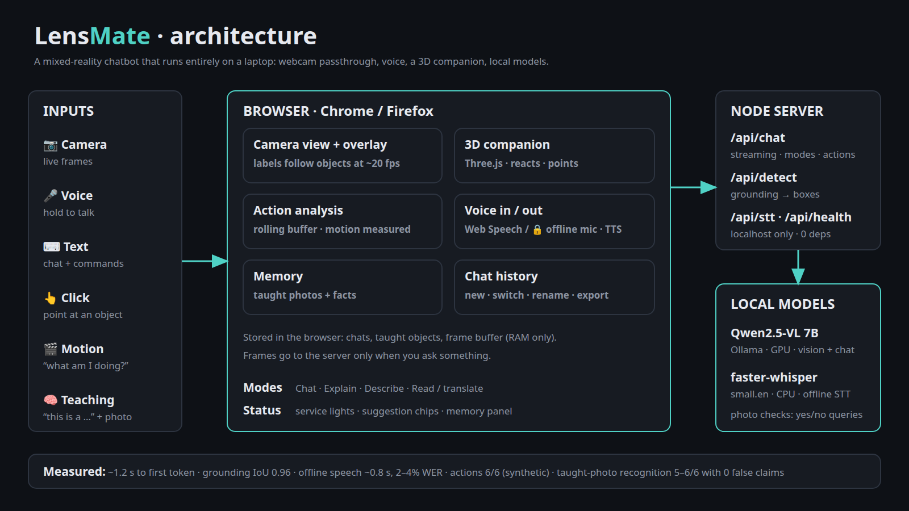

# LensMate: a general-purpose Mixed Reality chatbot

Point your camera at anything, talk to it, and an AI companion answers by voice, **draws labels on the live view**, and **flies over to the object it is talking about**. It runs on a laptop with a webcam, with no headset and no paid API. The vision-language model runs locally.

> Built for the *Introduction to Generative AI* course.



## What it does

| Capability | How |
|---|---|
| See and chat | Every question is sent with the current camera frame to a local vision-language model (Qwen2.5-VL 7B via Ollama). Replies stream in token by token. |
| Talk | Push-to-talk speech input (Web Speech API) and spoken replies (browser TTS), sentence by sentence while the answer streams. |
| Spatial labels | `find my keys`, `label everything`: the model returns bounding boxes (grounding), drawn as neon boxes over the video. |
| Label tracking | A lightweight block-matching tracker (~20 fps, CPU only) keeps each label on its object when the camera or object moves, and first catches the box up for the 1-3 s the model took to answer. |
| 3D companion | A Three.js orb that idles, listens, thinks, and talks, and flies next to the object it labelled. |
| Modes | 💬 Chat, 🎓 Explain, 👁 Describe (accessibility style), 📖 Read / translate. |
| Teach me | Say *"this is an L298N motor driver"* or *"remember that the red box is mine"*. The fact is injected into later prompts, persisted in the browser, and cleared with *"forget everything"*. |

## Architecture

```
 Browser (Chrome)                                   Node server              Ollama (local GPU)
┌────────────────────────────────────┐          ┌───────────────┐          ┌──────────────────┐
│ webcam ─► <video> (the "passthrough")│          │ POST /api/chat │ ───────► │ qwen2.5vl:7b      │
│ mic ─► Web Speech STT ─► text        │ ─frame─► │ POST /api/detect│ ◄─JSON── │ (vision + text)   │
│ canvas overlay ◄─ boxes + labels     │          │ static files   │          └──────────────────┘
│ Three.js avatar ◄─ state/point events│          └───────────────┘
│ TTS ◄─ streamed sentences            │
└────────────────────────────────────┘
```

Key design points:
- **Grounding calibration:** Qwen2.5-VL returns boxes in the pixel space of the image *after Ollama resizes it*. Smaller images are upscaled, so coordinates come back about 1.2× too large. Sending frames at exactly **1204×672** gives 1:1 coordinates, which I verified empirically (mean IoU 0.96 on the benchmark).
- **Tracking:** `tracker.js` matches each box's patch between small grayscale frames (sum of absolute differences, ±6 px per step). A box is dropped after 8 consecutive bad matches. Unit tests (`node eval/test_tracker.js`) and a headless-Chrome integration test (`eval/track_page.html`: box within 2 px after an 80 px pan) cover it.
- **Cheap context:** only the newest user turn carries an image. History is text-only.
- **Event bus:** the avatar listens to small `lens-state` and `lens-point` browser events, so UI modules stay decoupled.

## Run it

Requirements: Linux, Node 18+, [Ollama](https://ollama.com) with a vision model, Chrome or Edge (for speech recognition), a webcam. About 8 GB of VRAM is comfortable for the 7B model.

```bash
ollama pull qwen2.5vl:7b
cd lensmate && node server.js        # no npm install, no dependencies
# open http://localhost:3000 in Chrome and allow camera + microphone
```

Try: *"What is this?"*, *"label everything"*, *"find the scissors"*, hold **Space** to talk.

## Evaluation

`eval/` contains a reproducible harness that exercises the real server endpoints (`python3 eval/make_cases.py && python3 eval/run_eval.py`).

Results on the synthetic benchmark (8 cases, RTX 5060 Laptop 8 GB, Qwen2.5-VL 7B):

| Metric | Result |
|---|---|
| Chat / reading / describe / memory | **5/5** |
| Detection passing IoU ≥ 0.5 | **3/3** (mean IoU **0.96**) |
| Time to first token (median) | **1.3 s** |
| Full chat answer (median) | **1.5 s** |
| Detection scan (median) | **1.3 s** |

**Memory ablation:** asked *"What is the green triangle called?"* **with** the taught fact the model answers *"a Zorp"*, and **without** it, *"a triangle"*. So the improvement comes from the memory feature.

### Real-object evaluation (bring your own photos)
The synthetic benchmark is easy, so there is a second harness for real objects:
```bash
# 1. In the app, press 📷 on each object (about 20-30 frames: everyday items, niche hardware, text)
python3 eval/real_eval.py ingest ~/Downloads     # copies lensmate_*.jpg into eval/real/ (git-ignored, stays private)
# 2. Edit eval/real/labels.csv: put accepted names in `truth`, separated by |   e.g.  motor driver|l298n|h-bridge
python3 eval/real_eval.py run                    # asks "What is this object?", auto-scores, writes eval/real/results.csv
```
Results from this run belong in the table above once collected. With ~25 images the accuracy is indicative, not precise.

**Preliminary real-object results (2 objects, 4 photos each, auto-scored by keyword):**

| Object | Unaided | With taught fact |
|---|---|---|
| Mecanum wheel | 0/4 | 4/4 |
| Motor driver | 1/4 | 4/4 |

The model describes real features but mostly cannot name niche hardware: it called the mecanum wheel a "gear" or "roller", and the motor driver an "Arduino Uno" or a "DC-DC converter" (right category, wrong part); its one motor-driver hit also called an L298N a *stepper* driver, so keyword scoring is lenient. Taught facts make it name the object, but it does not add knowledge (a mecanum wheel was later explained as a "caster wheel"). The taught-fact column is an easy, optimistic test because the name is supplied.

### Honest limitations
- The benchmark is **synthetic** (clean shapes and text). It proves the pipeline, the grounding calibration, and the memory feature. It does **not** measure accuracy on real-world objects.
- In manual tests, the 7B model **misidentified niche hardware** (motor driver, mecanum wheel, ultrasonic sensor, a glue tube). Common objects are far more reliable. The teach-me memory and the "describe cues, give a labelled best guess" prompt are mitigations, not a cure. A larger or fine-tuned model would be the real fix.
- The tracker follows **translation only** (no scale or rotation), loses fast motion (more than about 24 px per frame step) or objects that leave the view, and ignores featureless patches. Tracking was tested on simulated camera motion, not yet on a live webcam. Labels auto-clear after 60 s.
- Chrome's speech recognition sends audio to a cloud service. Vision and reasoning are fully local.
- A webcam is not a headset. This is a "mixed reality" prototype (virtual companion and anchored labels over a live camera feed), not spatial mapping.

## Project layout

```
server.js            static server + /api/chat (streaming) + /api/detect (grounding), prompts and modes
public/app.js        camera, frame capture, chat streaming
public/voice.js      push-to-talk STT, sentence-level TTS
public/spatial.js    boxes over video, find/label commands, tracking loop
public/tracker.js    block-matching box tracker (pure functions, unit-tested)
public/avatar.js     Three.js companion (idle/listening/thinking/speaking/pointing)
public/ui.js         modes, teach-me memory, snapshot
eval/                benchmark generator, runner, results.json, tracker tests
```

## Future work
Tracking with scale and re-detection, a larger or fine-tuned vision model, local Whisper for fully offline speech, a WebXR build for a Quest headset, and visual (not just textual) memory of taught objects.
